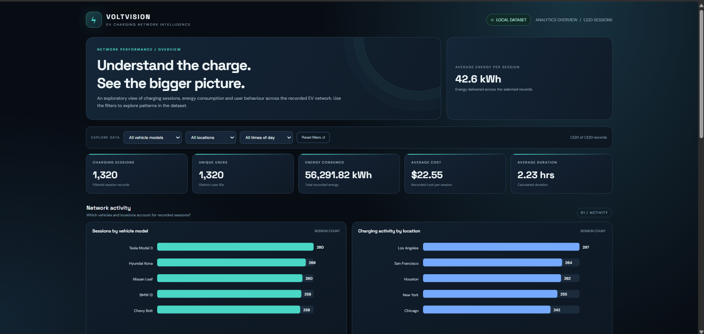
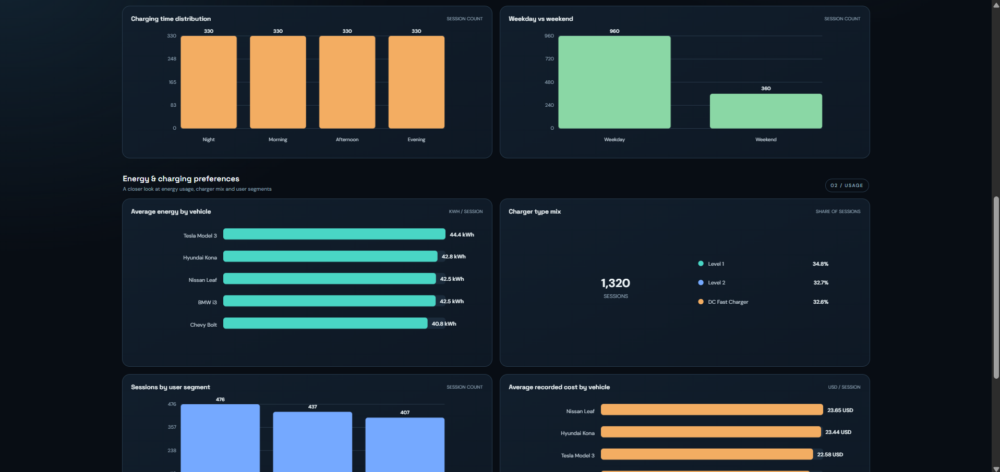

# ⚡ VoltVision – EV Charging Network Intelligence

An end-to-end data analytics project focused on exploring electric vehicle charging sessions, understanding user behaviour, analysing energy consumption and generating business insights to support EV charging network planning.

## 📌 Project Overview

VoltVision is a data analytics project that explores EV charging session data to understand charging patterns, vehicle performance, user behaviour and location-wise charging activity.

The project uses Python, Pandas, MySQL, SQL and an interactive HTML dashboard to transform raw charging data into meaningful insights.

## 🎯 Project Objectives

- Analyse EV charging session data.
- Understand charging behaviour across different user types.
- Compare energy consumption across vehicle models.
- Analyse charging activity across different locations.
- Explore hourly and monthly charging patterns.
- Identify business opportunities through data-driven insights.
- Present findings through an interactive dashboard.

## 🛠️ Tools & Technologies

| Tool / Technology | Purpose |
|---|---|
| Python | Data analysis and preprocessing |
| Pandas | Data cleaning and manipulation |
| Matplotlib | Exploratory data visualisation |
| MySQL | Database management |
| SQL | Data analysis and querying |
| HTML, CSS, JavaScript | Interactive dashboard |
| Jupyter Notebook | Analysis and documentation |
| VS Code | Development environment |
| Git & GitHub | Version control and project hosting |


## ⚙️ Installation & Setup

Follow these steps to run the project locally.

### 1. Clone the Repository

```bash
git https://github.com/sd-athar-irfan05/VoltVision.git
cd VoltVision
```

### 2. Create a Virtual Environment

```bash
python -m venv venv
```

Activate the environment:

**Windows:**
```bash
venv\Scripts\activate
```

### 3. Install Required Libraries

```bash
pip install -r requirements.txt
```

### 4. Run Jupyter Notebook

```bash
jupyter notebook
```

Open the notebooks inside the `notebooks/` folder and execute them in sequence.

### 5. Explore the SQL Analysis

- Create a MySQL database named `voltvision_db`.
- Import the prepared dataset into the `ev_charging_data` table.
- Refer to the SQL files inside the `sql/` folder.

### 6. Open the Interactive Dashboard

Navigate to the `dashboard/` folder and open:

`VoltVision_Network_Intelligence.html`

The dashboard will open in your default web browser.


## 📂 Project Structure

```text
VoltVision/
│
├── data/
│   ├── raw/
│   └── processed/
│
├── notebooks/
│   ├── 01_data_inspection.ipynb
│   ├── 02_exploratory_data_analysis.ipynb
│   ├── 03_sql_data_preparation.ipynb
│   └── 04_advanced_data_analysis.ipynb
│
├── sql/
│   ├── 04_vehicle_summary.sql
│   ├── 05_city_wise_analysis.sql
│   ├── 06_peak_hour_analysis.sql
│   ├── 07_user_type_analysis.sql
│   ├── 08_monthly_analysis.sql
│   ├── 09_day_wise_analysis.sql
│   ├── 10_time_of_day_analysis.sql
│   └── README.md
│
├── dashboard/
|   ├── index.html
│   ├── VoltVision_Network_Intelligence.html
│   └── README_FIRST.txt
│
├── reports/
│   └── business_insights.md
│
└── README.md
```

## 📊 Dataset Overview

- Total Records: 1,320
- Total Columns: 27
- Main Database: `voltvision_db`
- Main Table: `ev_charging_data`
- Summary Table: `vehicle_summary`

The dataset contains information related to EV charging sessions, vehicle models, energy consumption, charging costs, user types, charging locations and timestamps.

## 🔍 Key Analysis & Findings

### 1. User Behaviour Analysis

- Commuters recorded the highest number of charging sessions (476).
- Casual Drivers recorded the highest average energy consumption (44.41 kWh).
- Commuters had the highest average charging cost ($22.75).

### 2. Vehicle Performance Analysis

- Tesla Model 3 recorded the highest number of sessions (280).
- Tesla Model 3 also recorded the highest average energy consumption (44.42 kWh).
- Chevy Bolt recorded the lowest average energy consumption (40.84 kWh).

### 3. Charging Pattern Analysis

- Each hour recorded 55 charging sessions.
- No single peak hour was identified.
- The dataset shows an equal distribution of sessions across all 24 hours.

### 4. City-wise Charging Analysis

- Los Angeles recorded the highest charging activity (297 sessions).
- Chicago recorded the lowest charging activity (242 sessions).
- Chicago had the highest average charging cost ($23.72).
- San Francisco had the lowest average charging cost ($21.99).

## 📈 Interactive Dashboard

VoltVision includes an interactive HTML dashboard featuring:

- Key Performance Indicators (KPIs)
- Charging activity analysis
- Vehicle-wise comparisons
- User behaviour analysis
- Location-wise charging activity
- Interactive filters
- Dynamic insights

**Dashboard File:** `dashboard/VoltVision_Network_Intelligence.html`

To explore the dashboard, open the HTML file in a modern web browser.

### Dashboard Preview
🌐 **Live Dashboard:** [Explore VoltVision] (https://volt-vision-silk.vercel.app/)

#### Network Overview


#### Detailed Analytics



## 💡 Business Insights

The analysis highlights opportunities to:

- Explore commuter-focused charging plans.
- Monitor vehicle-wise energy consumption.
- Evaluate charging costs across locations.
- Improve location-wise network planning.
- Use actual demand data before making infrastructure expansion decisions.

Detailed findings and recommendations are available in:

`reports/business_insights.md`

## ⚠️ Project Limitations

- The dataset contains 1,320 charging sessions.
- Each user has one recorded session, so repeat customer behaviour cannot be evaluated.
- Hourly charging sessions are equally distributed in the dataset.
- Recorded charging costs are not independently verified business revenue.
- Findings describe the available dataset and should not be treated as real-world network forecasts.

## 👨‍💻 Author

**Syed Athar Irfan**

Data Analytics | Python | SQL | Excel | Power BI

---

⭐ If you find this project interesting, feel free to explore the repository!